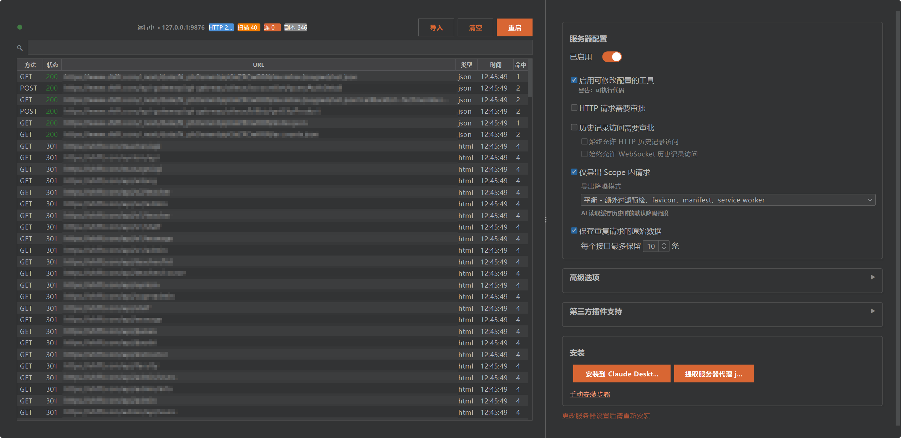

# Burp MCP Server（增强版）

用 MCP 把 Burp Suite 接给 AI 客户端（Claude Desktop、Cursor、Codex 等），并让它在**长时间真实使用**下不掉线、不卡死。

这个项目基于 PortSwigger 官方开源的 [mcp-server](https://github.com/PortSwigger/mcp-server)（GPLv3）。原版的 MCP 协议实现、Burp 扩展骨架和大部分工具定义都来自官方；我在这里做的是把它改成一个能连续跑几小时的工作环境：换传输、加本地缓存、补一个能配置的服务面板、把会卡死 Burp 的查询挪到后台。

如果你只是跑 demo，官方版足够；如果你打算让 AI 客户端连着 Burp 干一整天活，这个版本解决的正是那些问题。



## 原版在实际使用里的几个问题

- **SSE 长连接不稳**：AI 客户端隔几分钟断开重连，工具调用经常中途失败；
- **每次查询都实时打 Burp API**：代理历史一多，查一次历史就把 Burp UI 拖到无响应；
- **大响应没法用**：几 MB 的响应塞进上下文，token 直接烧完，还经常被截断；
- **配置分散**：审批、导出、缓存、Scope 这些开关散落在各处，没有一个地方能看清楚当前状态。

## 这个版本改了什么

| 方向 | 做法 |
|---|---|
| 传输 | 主通道换成 **Streamable HTTP**（MCP 2025-03-26），保留 SSE 兼容模式；没有长连接，也就没有"用着用着掉线" |
| 数据 | 后台导出器把 HTTP 历史、WebSocket 历史和扫描问题增量同步到本地 SQLite，查询走缓存 |
| 性能 | 分页 + 按 ID 取详情；SHA-256 去重（`method + URL`，5 分钟窗口）；自动清理旧数据 |
| 大响应 | 异步任务：`submit_task` 立即返回 ID，结果落文件，用 `get_task_result` / `read_file` 分块取 |
| 界面 | Burp 里新增服务面板：服务状态、缓存统计、导出器状态、审批策略、Scope 过滤、一键安装客户端 |
| 安全 | HTTP 请求与历史访问默认需要审批，可按目标配置自动放行；严格 localhost 模式可关掉以支持 WSL / 远程 |

## 快速开始

### 构建

需要 Java 21+，且本机能用 `jar`：

```bash
git clone https://github.com/leilecen/burpmcpenhance.git
cd burpmcpenhance
./gradlew embedProxyJar
```

产物：

```text
build/libs/burp-mcp-all.jar
```

### 装进 Burp

1. 打开 Burp Suite → `Extensions` → `Add`；
2. Extension type 选 `Java`，选中上面那个 jar；
3. 在 Burp 的 `MCP` 面板里把服务打开。

默认监听 `http://127.0.0.1:9876`。

### 接 AI 客户端

推荐 Streamable HTTP：

```json
{
  "mcpServers": {
    "burp": {
      "type": "http",
      "url": "http://127.0.0.1:9876/mcp"
    }
  }
}
```

如果客户端只支持 stdio，用内置的 `mcp-proxy-all.jar` 桥接：

```json
{
  "mcpServers": {
    "burp": {
      "command": "java",
      "args": ["-jar", "/path/to/mcp-proxy-all.jar", "--sse-url", "http://127.0.0.1:9876/sse"]
    }
  }
}
```

Burp 面板里也有"安装到 Claude Desktop"和"提取服务器代理 jar"两个按钮，省去手写配置。

## 配置

面板里的主要开关（都持久化在 Burp 的 project/user 配置里）：

| 选项 | 说明 | 默认 |
|---|---|---|
| 服务器主机 / 端口 | 监听地址 | `127.0.0.1:9876` |
| 严格 localhost 模式 | WSL / 远程访问时关闭 | 开启 |
| 保活心跳 / 间隔 | 仅 SSE 模式需要 | 开启 / 30s |
| 最大响应大小 | 单次响应上限 | 100 KB |
| HTTP 请求审批 | 发包前是否等操作员确认 | 开启 |
| 历史记录访问审批 | 读代理历史前是否等确认 | 开启 |
| 仅导出 Scope 内请求 | 减少噪音 | 关闭 |

自动放行目标（`manage_auto_approve_targets`）按域名/主机维护，比如 `example.com`、`127.0.0.1:8080`、`*.corp.example`。

## 工具一览

按用途分组，完整定义在 `src/main/kotlin/net/portswigger/mcp/tools/`。

- **HTTP**：`send_http1_request`、`send_http2_request`、`create_repeater_tab`、`send_to_intruder`
- **历史与缓存**：`get_proxy_http_history`、`get_proxy_websocket_history`、`list_proxy_http_history`、`get_proxy_http_detail`、`exporter_stats`
- **Scope / 站点 / 扫描**：`manage_scope`、`get_site_map`、`start_active_scan`（Pro）、`list_scanner_issues`、`get_scanner_issue_detail`
- **GraphQL**：`graphql_introspect`、`graphql_list_types`、`graphql_describe_type`、`graphql_query`
- **对比与配置**：`diff_proxy_responses`、`manage_auto_approve_targets`、`set_task_execution_engine_state`、`set_proxy_intercept_state`、`clear_database`、`get_burp_info`
- **异步任务**：`submit_task`、`get_task_result`、`read_file`、`delete_file`

## 架构

```text
+---------------------------------------------------+
|                   Burp Suite                      |
|  +----------------------------------------------+ |
|  |          MCP Server Extension                | |
|  |  +------------------+  +-------------------+ | |
|  |  | POST /mcp        |  | GET+POST /sse     | | |
|  |  | (Streamable HTTP)|  | (SSE 兼容模式)    | | |
|  |  +------------------+  +-------------------+ | |
|  |  +-------------+  +-----------------------+  | |
|  |  | Exporter    |->|  SQLite 本地缓存      |  | |
|  |  | (后台增量)   |  |  (HTTP/WS/扫描问题)   |  | |
|  |  +-------------+  +-----------------------+  | |
|  +----------------------------------------------+ |
+----------+------------------+---------------------+
           |                  |
    +------+------+    +------+------+
    | MCP Client  |    | MCP Client  |
    | (HTTP)      |    | (旧版/代理) |
    +-------------+    +-------------+
```

主要模块：

- `src/main/kotlin/net/portswigger/mcp/tools/` — MCP 工具定义；
- `.../exporter/` — 后台增量导出器与 SQLite 落库；
- `.../db/` — 数据库与查询层；
- `.../queue/` — 异步任务与消息队列；
- `.../config/` — 配置项与迁移；
- `commonMain/io/ktor/` — 为修 SSE 行为而 vendored 的 Ktor client 源码（Apache 2.0，保留原版权头）。

## 开发

```bash
./gradlew test          # 单元测试
./gradlew shadowJar     # 只打主 jar
./gradlew embedProxyJar # 打最终分发包（含 stdio 代理 jar）
```

构建和测试都在本地跑，需要 JDK 21；第一次构建会由 Gradle wrapper 拉依赖。

## 已知限制

- `start_active_scan` 需要 Burp Professional；
- 严格 localhost 模式关闭后，服务会监听非回环地址，请自行确认网络可达性，别把没鉴权的端口暴露到公网；
- 缓存是本地 SQLite，项目切来切去时历史不会自动合并（按项目配置存）。

## 许可

[GPLv3](LICENSE)，与上游一致。原始版权归 PortSwigger Ltd.，本仓库是在其基础上的修改版本；修改部分同样以 GPLv3 发布。

如果这个扩展对你有用，建议也给上游点个 star：<https://github.com/PortSwigger/mcp-server>。

---

## English

An enhanced fork of PortSwigger's MCP server for Burp Suite, built for long-running sessions rather than demos.

The official server uses SSE as its primary transport and queries Burp's API directly on every request, which breaks down once proxy history grows. This fork switches the main transport to Streamable HTTP (keeping SSE for compatibility), adds a background exporter with a local SQLite cache, moves large responses to an async task/file model, and ships a control panel inside Burp for server, cache, approval and scope settings.

Build with `./gradlew embedProxyJar` (Java 21+), load `build/libs/burp-mcp-all.jar` into Burp, enable the MCP server, then point your client at `http://127.0.0.1:9876/mcp`.

Licensed under GPLv3, same as upstream. Original copyright PortSwigger Ltd.; see [LICENSE](LICENSE).
